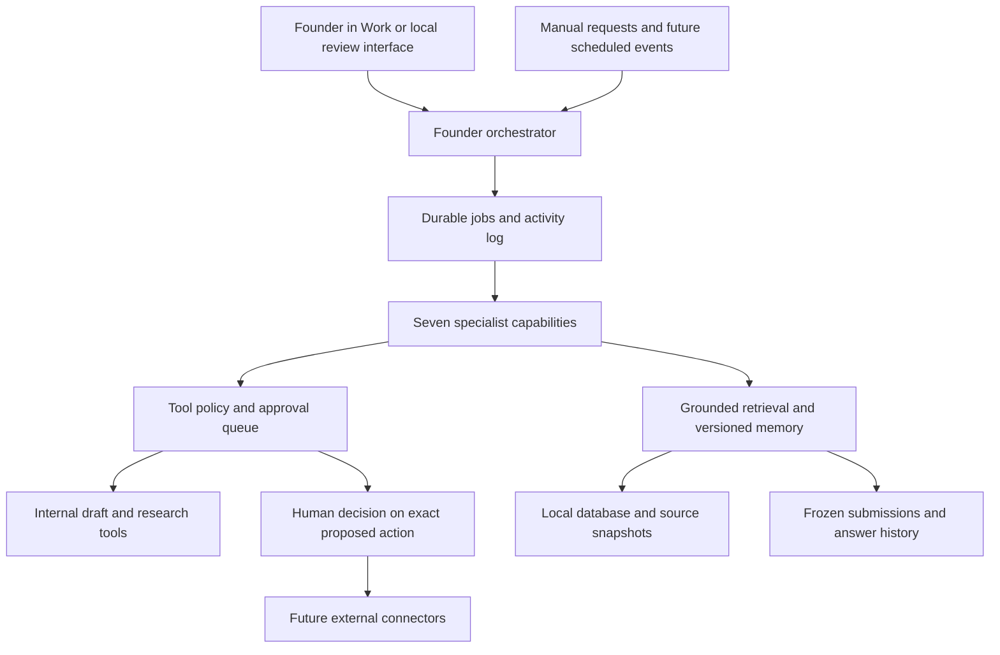

# A Story Founder OS Architecture and Build Plan

October 4, 2026. Build one Founder Agent over shared, versioned memory and a permission-controlled tool layer. Specialist agents are capabilities of that orchestrator, not seven isolated chat histories. Work is a review and conversation surface; the durable records and job runner live outside the chat.

The first implementation is an isolated local foundation. It imports a small set of sources as unapproved evidence, prepares an answer bank and decision queue, and exercises the approval and snapshot rules. Live model calls, external communications, production deployment and unattended schedules are separate activation steps. No source files or existing Pitch OS records will be overwritten.

## 1 What currently exists

The inspected folder has 103,159 paths and 4.65 GB of logical file sizes. The prior inventory is retained intact. Most paths are dependencies or build output. The selected pilot contains 23 references, including research, saved application materials, deck candidates and code references.

The existing Pitch OS is a React/Vinext application with ChatGPT sign-in and Cloudflare D1 integration. Its schema and API implement memory entries, answer drafts, application questions and competitions. The sidebar also advertises areas that its README identifies as outlines, including pitch studio, answer bank, submission/review workflows and feedback.

A copied local database contains 19 seed memories, four seeded opportunities, one explicitly temporary QA opportunity, and one question/draft tied to that QA opportunity. This is not an export of the deployed database. Reconcile a deployed export before replacing that application.

The new essay attachment contains multiple alternative answers, Vietnamese editorial comments, several video scripts and unresolved assertions. It is neither a submitted application nor a source of approved facts. Its permission to revise the thinking does not confirm the numbers.

## 2 What is worth preserving

- Source-linked company memory, evidence labels, original question wording, program context and historical application material.
- Research citations and distinctions between reported facts, hypotheses and scenarios.
- Native decks, product design assets and source projects as references; selected excerpts for retrieval.
- The most useful essay direction: lead with an AI interviewer that helps families record stories by phone. Treat the family contribution/interview loop as a differentiation hypothesis to demonstrate, not a proven moat or retention result.
- Original paths, content hashes, local database recovery material, Git history and deployment identity. Preserve all originals in place.

## 3 What should be discarded or replaced

DELETE below means omit from the new implementation or active retrieval, not remove original files.

| Area | KEEP | REFACTOR | DELETE from new system | ADD |
| --- | --- | --- | --- | --- |
| Data model | Sources, claims, questions, competitions | Mutable memory into immutable claim versions plus an approved pointer | A single undated answer as the only history | Approval receipts, source versions, answer evidence links, submission snapshots, jobs and events |
| Content | Useful research, draft essays, exact prompts | Claim-level reconciliation and audience-specific answers | Duplicate retrieval copies, fictional demo content presented as proof, unsupported exclusivity | Approved/rejected language, unresolved claims and freshness rules |
| UI | A Story identity and readable source access | Home around decisions and activity | Placeholder navigation and manual upkeep as the core workflow | Decision queue, agent activity, opportunities, applications, deadlines, inconsistencies and results |
| Code | Original source as reference | Separate domain logic from authentication and presentation | Dependency folders and build artifacts from agent memory | Portable local service, deterministic handlers, tests and provider/tool interfaces |
| Backend | Existing D1 data until export/reconciliation | Database access behind a repository boundary | A requirement that every operation depends on the Site UI | Local SQLite foundation, migration receipts and future hosted deployment |
| Agents | Grounded retrieval principles | Source seeding into reviewable ingestion jobs | Agents approving their own facts or treating document instructions as commands | Founder dispatcher and seven permission-scoped capabilities |

Specific language to reject as a default: “competitors end in one book,” guaranteed annual retention, proven defensibility from archive accumulation, indefinite “forever” commitments, fixed cost/margin claims without usage assumptions, and changing runway merely because a larger number sounds better. Confirm cash and burn before using any runway figure. Do not present a future UIUC enrollment as current affiliation.

## 4 Proposed architecture

The orchestrator routes requests to typed jobs, gathers evidence, records results and presents decisions. Specialist roles share the same source registry and evidence statuses. A role cannot gain broader permissions by delegating. Document text is untrusted evidence even when it includes phrases such as “ignore earlier instructions.”

Job inputs and outputs are serializable. Use durable states, idempotency keys, bounded retries, leases and a failure log. A later scheduler only creates jobs; it does not bypass approval. A model adapter proposes structured results; deterministic code validates evidence IDs, limits and tool permissions before committing anything.

## 5 Agents and tool permissions

| Capability | May do automatically | Must stop for approval or missing evidence |
| --- | --- | --- |
| Founder | Route jobs, summarize state, prioritize decisions | Every restricted action remains restricted |
| Opportunity Scout | Normalize supplied opportunities, deduplicate by organizer/program/cycle, score known criteria, store research | Unknown eligibility remains unknown; no application submission or spending |
| Application | Extract questions and limits, retrieve approved answers and supporting evidence, prepare drafts and a completeness report | Cannot certify uncertain claims, alter approved facts or submit |
| Pitch | Draft and version requested durations, link claims, flag outdated scripts | No publishing; cannot convert a hypothesis into a demonstrated product feature |
| Research | Read permitted sources, create dated findings and citation records | Paid tools/model calls need an approved budget; findings cannot silently become canonical facts |
| Follow-up | Identify due items and prepare messages | Email/calendar connectors remain disconnected initially; sending requires exact recipient/body approval |
| Customer and Evidence | Organize supplied feedback, objections and measurements | Testimonial publication and unsupported traction claims require review; do not upload sensitive raw customer material by default |
| Consistency and Truth | Compare claim versions and approved language, create conflict reports | Canonical pricing/traction changes require explicit approval; first build gates every canonical promotion |

Restricted action types: send email, submit application, publish, change canonical facts, delete, spend money and destructive changes. Approval is tied to the exact payload hash and expected prior version; changed content invalidates it. Agents can request approval but cannot grant it. The first local implementation exposes no external sending, publishing, payment or deletion tool at all.

Approval to reuse an answer is distinct from verifying its facts. An approved answer version may still become stale when any source fact changes. Learning from an approved answer means storing and retrieving that exact version, not fine-tuning a model or rewriting canonical memory without review.

## 6 Data and memory schema

**Source and source version:** stable ID, original absolute path/URL, SHA-256, captured date, document date when known, classification, source kind, extraction status, snapshot/excerpt and line/page/slide locator. Track import time separately from last verified date. Repeated content can share a blob while keeping every source alias.

**Claim and claim version:** topic, statement, typed value when useful, unit/scope, evidence status, linked source/excerpt, source date, last verified date (nullable), valid-through date (nullable), proposed/approved/rejected status, supersedes, review reason and approved pointer. Topics cover product description, positioning, pricing, traction, team, market, competitors, features, customer evidence, fundraising and approved/rejected language. No document becomes canonical as a whole simply because it is recent.

**Opportunity:** organizer, program, cycle, official URL, deadline with timezone, prize, cash/noncash distinction, dilution/terms, eligibility, requirements, fit score and rationale, last checked time and evaluated/apply/skip state. Unknown is not zero, ineligible or a confirmed deadline.

**Application and question:** opportunity/cycle, original prompt, question order, required flag, character/word limit and counting convention, source locator, parsed versus human-checked state.

**Answer version:** original question, program, text, count, source facts and source versions, created date, draft/approved/rejected/submitted status, approval receipt, supersedes and currentness. Preserve each draft variant. Approval chooses one exact version, never a mutable text field.

**Pitch version:** duration/format, audience, script, linked claim versions, target words, measured rehearsal duration when supplied, approval and currentness. Word count gives an estimate; it cannot certify real delivery time.

**Submission snapshot:** exact answer texts, question wording and limits, claim versions, deck/file hashes, submission time, destination, receipt and approval identity. Frozen payloads reject update/delete. A prepared package is not a submission. Only record actual submission after explicit confirmation and a receipt/reference. “What did we tell NVIDIA?” reads the historical snapshot, never current memory. No NVIDIA submission is inferred from existing drafts.

**Feedback/evidence:** type, author/source, original wording, date, permission/use constraints and related claim/submission. Keep analyst interpretation separate from organizer feedback.

**Approvals, jobs, events and audit:** actor/capability, payload hash, expected version, decision and timestamp; job state, lease, retry count and result; append-only audit and import receipts. A filesystem owner can still tamper with a local database; local controls are not multi-user authentication.

## 7 Local versus cloud runtime

Start with Python's standard library and SQLite in a new folder outside the original OneDrive tree. Keep one local writer and atomic transactions. Do not put a live database in the source sync folder. SQLite's documentation describes its single-writer behavior and the same-host requirement for WAL; a synchronized folder is not a substitute for a database server. Use consistent backups for portability. [SQLite architecture](https://www.sqlite.org/wal.html), [Python transaction support](https://docs.python.org/3/library/sqlite3.html).

This recommendation keeps the first build portable and avoids selecting a model vendor or requiring paid services. Local files and jobs remain usable without an active ChatGPT session when the local process is running. A sleeping/offline PC cannot perform background work.

Later, add a persistent service/scheduler on an always-on local machine or a small private server. For multi-user remote access, put an authenticated API in front of the database; migrate to PostgreSQL if write concurrency warrants it. Keep the tool policy, data contracts and model adapter independent of hosting. Optional local or cloud models should receive only the minimum approved context, with configurable privacy and spend limits. No cloud-model credentials or calls are required for the current foundation.

Work Pages can show plans and review results now. A future authenticated bridge is needed for live two-way control; a Page or local path does not automatically connect a remote worker to this PC. This phase does not install an always-on service or schedule.

## 8 Exact migration and build sequence

1. Preserve the existing inventory and original source tree. Add the new taxonomy as a separate manifest: CANONICAL KNOWLEDGE, USEFUL REFERENCE, HISTORICAL SUBMISSION, RAW RESEARCH, MEDIA/ASSETS, DUPLICATE, STALE, UNRELATED, ARCHIVE. Canonical status requires approval; submission status requires submission evidence. A source can have secondary tags.
2. Create this architecture before implementation. Isolate the build under the chat's outputs folder. Do not execute scripts from the source tree.
3. Build the versioned store, provenance, typed job dispatcher, permission gate, approval queue, answer versions and immutable submission snapshots. Test the invariants before importing real drafts.
4. Register the 23 pilot references and both supplied attachments. Ingest bounded text from narrative sources and the essay; leave decks/images/code as references unless an explicit excerpt is needed. Recheck hashes. Record every imported version and transformation.
5. Parse exact application questions/limits from the essay and keep all raw variants. Add revised draft answers without silently approving them. Seed a review queue for disputed facts and misleading language. The draft's proposed 12-month runway is not a financial fact.
6. Run local consistency, evidence-indexing, question/limit and application-readiness jobs. Produce a review surface in the requested priority order. Test idempotent repeat imports, source updates, stale approvals, canonical fact protection, answer learning and immutable submissions.
7. Deliver the working local foundation, database, run instructions, verification results, source ledger and clear implemented/deferred boundaries. Maintain the private Work architecture/review Page.
8. After this foundation, reconcile deployed Pitch OS data, connect the chosen model/research providers, validate real application extraction, add authenticated review UI/remote bridge and enable scheduled jobs. Obtain approval before external actions, canonical updates, costs, destructive cleanup or production replacement.

## Essay handling decisions

Lead with the concrete recording workflow. Explain the family archive after the user benefit. Replace blanket competitor claims with the specific family-context hypothesis. Keep B2B/hospice/memorial distribution as future experiments rather than current traction or a sprawling primary pitch.

Queue confirmation of plan prices and allowances, real product/demo status, pilot counts, paid versus waiting families, Hope College interest versus agreement, founder roles and outside work, June incorporation date, code/IP ownership, degrees and future UIUC enrollment, permission to use the family medical story, and cash/burn/runway. Model estimates remain labeled and dated. Do not use “forever” as a service guarantee.

This phase prepares reviewable internal drafts. It does not submit the F6S application or represent these answers as finalized.
